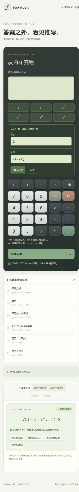

# FORMULA · 科学计算器 V1.0 + 完整求解第一阶段

原生 HTML/CSS/JavaScript 科学计算器，包含复数运算、方程求解和基于 SymPy 的拉普拉斯逐步推导。完整求解在浏览器的 Pyodide Web Worker 中完成；数学资源和 KaTeX 随仓库保存，无运行时 CDN 依赖。

### 快速启动

```powershell
python -m pip install -r requirements.txt
python server.py
```

打开 http://127.0.0.1:4173/ 使用计算器，或 http://127.0.0.1:4173/solver.html 进入完整求解。网页端首次求解加载约18 MB计算资源；使用新版浏览器。Node.js和Python开发环境下运行 `npm test` 可执行95项回归测试。

普通计算器支持科学函数、复数直角/极坐标、DEG/RAD、三类方程和本地历史。拉普拉斯页面支持中文括号、屏幕键盘、分子/分母输入、真实系数消元、逐项反变换及正变换验证。具体范围和手机发布方式见下文。



## 拉普拉斯键盘与分数输入（2026-11-03）

新增与普通计算器风格一致的屏幕键盘。点击数字、s、括号、四则和^可输入；←/→移动光标，DEL删除，AC清空当前编辑区，=求解。键盘不会主动聚焦输入框；点击输入框仍可使用手机系统键盘。普通计算器和拉普拉斯都兼容中文括号，例如`1/（s（s+1））`。

输入分数时点a/b：未选中内容时，当前表达式作为分子（空表达式默认1）；选中内容时，以选中部分作为分子。上下两栏分别为分子和分母，下方键盘默认编辑分母，点击分子输入框可切换。插入时自动生成`(分子)/(分母)`。例如先按AC、1、a/b，再按s、(、s、+、1、)，最后按=，即可计算`1/(s(s+1))`，结果`1-exp(-t)`。中文括号可混用，程序统一解析。

需要手动输入时，复合分母仍应分组，例如`1/(s(s+1))`。程序不会把`1/s(s+1)`自行猜改为整个乘积作分母；a/b输入区可自动完成括号分组。

## 手机输入改进（2026-11-03）

普通计算器的屏幕按键不再主动聚焦输入框，避免每按一个数字都弹出手机系统键盘。需要直接输入时点击表达式框即可；桌面键盘快捷键保持有效。

拉普拉斯输入框下方提供 `s`、`s²`、`s³`、`x²`、`x³`、`xⁿ`：前3个插入变量或其幂；x²/x³在光标处插入^2/^3，选中部分时整体加幂；xⁿ打开指数选择区，填写-12到12的整数并点“插入次方”。例如选中`s+1`后点击x²得到`(s+1)^2`。加幂仍受分子10次、分母8次等原限制；点击快捷按钮不会主动弹键盘，编辑指数时需点击对应输入框。

修改后运行 `npm test` 和 `python scripts/package-mobile.py`，再把上一级的 `formula-mobile-publish.zip` 上传到**原腾讯云项目的新建部署**。本地文件修改不会自动同步到线上，也不需要创建新的云项目。

## 手机分享版更新（2026-11-02）

完整求解现已默认在浏览器Web Worker中运行Pyodide + SymPy。手机访问静态HTTPS网址即可使用，不再需要接收者安装Python，也不依赖分享者电脑的本地API。首次求解加载约18 MB资源；全部资源同源自托管，无运行时国外CDN。手机性能较低时加载和求解更慢，尚未在实体手机上逐一测试。

直接发布使用上一级目录的 `formula-mobile-publish.zip`（根目录index.html），源文件位于 `formula-mobile/`。包中不含后端、历史数据或管理文档。可通过腾讯EdgeOne Makers的免费静态托管发布；账号注册、平台配额和最终域名需要在实际控制台确认。正式公网发布尚未完成，不能将127.0.0.1链接发给别人使用。

本地预览仍可运行 `python server.py` 或 `npm start`；后端API继续保留作开发验证，但网页默认不调用它。双击HTML不能使用Worker完整求解，应通过HTTP/HTTPS打开。服务器必须正确返回`.mjs`为`text/javascript`、`.wasm`为`application/wasm`，不能将脚本标成text/plain；`edgeone.json`已配置。

改动数学源码后运行 `python scripts/build-browser-bundle.py`，再运行 `npm test`（共91项），最后运行 `python scripts/package-mobile.py` 重新生成发布包。`npm run test:browser` 单独测试实际Pyodide/SymPy运行时。原有Python API相关说明在下方保留，完整求解的默认执行方式以本节为准。

原生 HTML / CSS / JavaScript 科学计算器，保留普通计算、复数和方程功能。新增本地 Python / SymPy 解题工作台，按真实运算记录展示部分分式和拉普拉斯反变换过程。运行时不需要互联网，KaTeX 脚本、样式和字体已放入项目。

## 启动完整功能

需要 Python 3.10+。首次安装依赖时需要联网；本机已经安装 SymPy 1.14.0 时可以跳过安装命令。安装之后断网也可计算。

在本项目目录打开 PowerShell：

```powershell
python -m pip install -r requirements.txt
python server.py
```

浏览器打开 **http://127.0.0.1:4173/solver.html**，点击「完整求解」，或直接点击左侧六个验收示例。原计算器入口是 **http://127.0.0.1:4173/**。终端按 Ctrl+C 停止。

也可以使用 Node.js 18+ 运行 `npm start`，它会启动同一个 Python 服务。不需要 `npm install`。需要指定 Python 可执行文件时，设置 `$env:PYTHON='Python可执行文件的完整路径'` 后运行 `npm start`。端口占用时，先停止旧预览进程，或设置 `$env:PORT=4174` 后运行 `python server.py`。

双击 **index.html** 仍可使用原有数值计算器。完整符号求解必须通过上面的服务启动；普通静态服务器 `python -m http.server` 不提供符号接口。

## 完整求解的使用和数学约定

1. 输入 `F(s)=(2s+5)/(s²+5s+6)` 或省略 `F(s)=`，点击「完整求解」；Ctrl+Enter 也可提交。
2. 页面显示因式分解、真/假分式判断、多项式长除法、待定系数设立、同次幂方程、真实初等行变换、部分分式、公式匹配、逐项反变换及正变换验证。
3. 顶部切换「仅显示答案 / 显示关键步骤 / 显示详细推导」。详细步骤可单独点击收起，或全部展开/收起。
4. 可复制最终答案文本、答案 LaTeX、频域表达式、完整推导，以及每条公式的 LaTeX。

验收样例得到 `f(t)=exp(-2*t)+exp(-3*t), t>=0`，系数方程为 `A+B=2`、`3A+2B=5`，解为 `A=B=1`。

| 示例 | 输入 | 时域结果 |
| --- | --- | --- |
| 不同实根 | `(2s+5)/(s^2+5s+6)` | `exp(-2t)+exp(-3t)` |
| 重根 | `(s+3)/(s+1)^2` | `(1+2t)exp(-t)` |
| 不可约二次因式 | `(2s+5)/(s^2+2s+5)` | `exp(-t)[2cos(2t)+(3/2)sin(2t)]` |
| 假分式 | `(s^2+2s+3)/(s+1)` | `δ'(t)+δ(t)+2exp(-t)` |
| 重复二次因式 | `1/(s^2+1)^2` | `[sin(t)-t cos(t)]/2` |
| 余弦变换对 | `s/(s^2+9)` | `cos(3t)` |

支持有理数系数（整数、小数、分数）、变量 s，分子≤10次、分母≤8次；分母在有理数域分解后，每个不可约因式不超过二次。二次因式的实根可含根式。一次/二次因式的重根均有对应模板；不可约二次因式用一次分子，不会强行拆成实数一次因式。

常见指数、正弦、余弦指其**对应的有理型 F(s)**，不是在输入框键入时域 `sin(t)`。暂不支持时移 `exp(-as)`、初始条件、任意阶跃/分段输入、符号参数以及三次或更高的不可约因式；会明确提示，不生成猜测步骤。每个任务20秒超时、最多同时2个任务，复杂题目可能被拒绝。

假分式商中的 `s^n` 对应 `δ^(n)(t)`，不是 `t^n`。采用因果变换的 **0⁻ 下限**：`L{δ^(n)}=s^n`。含冲激时，原点按分布解释，常规部分在 t>0 成立。无冲激时按 t≥0 表示，并给出右半平面收敛域。

正变换验证并非数值抽样：SymPy 对常规项计算精确正变换，并与独立反变换交叉核对；分式恒等式也需精确为零差。对于 SymPy 未直接求值的冲激导数，使用分布配对 `(-1)^n (d^n/dt^n exp(-st))|t=0`，由 SymPy 求导验证；页面标注该方法。任意检查失败都停止输出成功答案。

手机分享版已采用Pyodide 314.0.7运行同一套SymPy源码；原本地Python服务继续保留。浏览器计算超时通过终止Worker实现，页面保持可操作；新Worker需要重新初始化。

## 使用

- 普通计算：输入表达式，按 Enter 或 =。鼠标或键盘均可输入；Esc 清空；Backspace 删除光标前内容；支持选择后替换。
- `sin(30)` 默认使用 DEG；切换 RAD 后按 = 重新计算。显式 `30°` 在两种模式下均表示30度。SHIFT 将 sin/cos/tan 切为 asin/acos/atan，使用一次后复原。
- 根号 `sqrt(144)` 或 `√144`；幂 `2^3`；分数 `1/3+1/6`；`log` 是常用对数；`ln` 是自然对数。
- 百分数统一表示÷100：`200×10%=20`，`100+10%=100.1`。
- 幂右结合：`2^3^2=512`；`-2^2=-4`；隐式乘法与乘除同优先级并从左到右，建议用括号明确分母，如 `1/(2π)`。
- 结果后按运算符继续运算；输入数字开始新计算。`Ans` 保留最近一次成功的普通/复数结果，AC不清除 Ans。
- 复数模式：输入 `(3+4j)×(1+2j)`；右侧显示最近一次成功计算的模长、相角及极坐标。按 j 键自动切至复数模式。零复数相角未定义。
- 方程模式：选择类型，填入实数系数并求解。一次和二次方程右侧统一为0；方程组右侧是常数。
- 历史：成功计算自动保存最近50条。点击恢复表达式或方程系数，恢复原角度和模式；历史中的 Ans 使用计算时的值。清空后无法恢复。
- 复制：点击“复制结果”。浏览器拒绝剪贴板时，可选中显示结果手动复制。

## 文件

```text
index.html         页面结构
style.css          外壳、按键、屏幕及响应式样式
engine.js          解析器、复数运算及方程算法
app.js             模式、输入、历史与交互
solver.html/js/css 完整求解输入、三种视图、KaTeX和复制
math_parser.py     白名单有理式解析，无源码执行
symbolic_solver.py SymPy精确代数、消元、变换及验证
solution_steps.py  独立推导呈现模块，使用实际运算记录
server.py          本地HTTP服务及隔离求解进程
server.cjs         npm start的Python启动器
requirements.txt   Python依赖版本
vendor/katex/      KaTeX 0.19.1及字体、MIT许可证
tests/engine.test.cjs  自动测试
tests/test_symbolic.py 符号数学与HTTP服务测试
需求.txt           功能与验收条件
当前进度.txt       实现状态、验证及限制
```

## 测试

```powershell
npm test
```

共82项：58项原数值引擎测试、24项Python符号与服务测试。也可分别运行 `node --test tests/engine.test.cjs` 和 `python -m unittest discover -s tests -p test_symbolic.py`。浏览器实测记录见 `测试报告.md`。

## 数值及安全边界

原数值计算器内部为 JavaScript IEEE-754 双精度，结果显示12位有效数字以抑制浮点尾差。阶乘支持0到170，表达式最多1000字符、嵌套最多100层。分数使用 a/b 输入，小数输出；无二维分式编辑器。新解题模块使用 SymPy 精确有理运算，最多500字符、250个符号、40层嵌套，整数幂指数限定-12至12；求解范围另见上文。

两个解析器均通过白名单分词及运算优先级解析；Python端不对用户字符串调用 eval、sympify 或 parse_expr。用户输入不会作为 HTML 插入。服务仅监听127.0.0.1，无数据库、登录及遥测；求解不会上传外部服务。原计算历史仍保存在localStorage。

参考：[SymPy 拉普拉斯变换与0⁻约定](https://docs.sympy.org/latest/modules/integrals/integrals.html#sympy.integrals.transforms.laplace_transform)、[KaTeX 本地部署](https://katex.org/docs/browser)。项目随附 KaTeX MIT 许可证；SymPy 依赖遵循其 BSD 许可证。

继续开发前先阅读 `需求.txt` 和 `当前进度.txt`；完成后更新进度并重跑相关测试。
